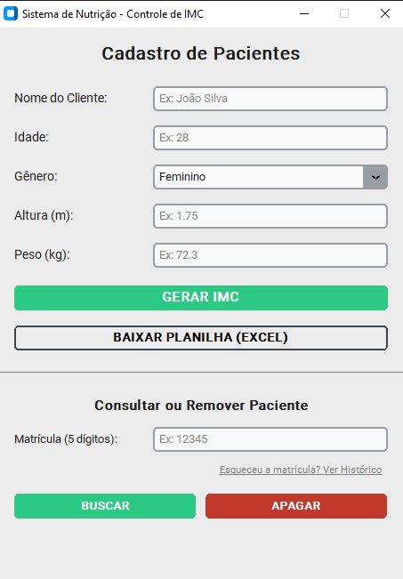
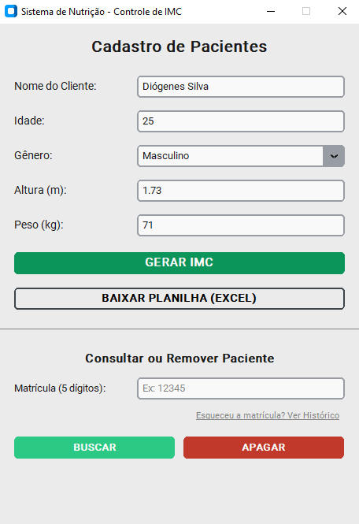
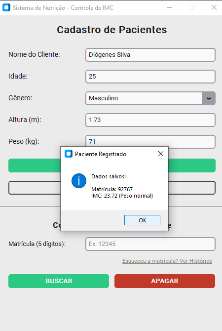

# NutriControl 🥗

### Sistema de Gerenciamento Nutricional em Python

O **NutriControl** é uma aplicação desktop desenvolvida em Python com o objetivo de auxiliar profissionais de nutrição no cadastro, gerenciamento e consulta de pacientes.

O sistema integra o cálculo do Índice de Massa Corporal (IMC) a uma ferramenta de gerenciamento de pacientes, permitindo armazenar informações, consultar registros e exportar dados em planilhas Excel.

O projeto surgiu a partir de uma atividade acadêmica, na qual buscamos ir além de uma calculadora convencional de IMC, desenvolvendo uma aplicação com uma proposta de utilização prática em um consultório de nutrição.

---

## 🎯 Objetivo do Projeto

Aplicar os conhecimentos adquiridos na disciplina de Introdução à Programação em Python, explorando conceitos de Programação Orientada a Objetos (POO), desenvolvimento de interfaces gráficas e manipulação de arquivos.

Além da proposta acadêmica, buscamos desenvolver uma ferramenta simples que pudesse contribuir para a organização dos registros de pacientes em um ambiente de atendimento nutricional.

## ⚙️ Funcionalidades

- **Cadastro de pacientes:** registro de nome, idade, gênero, altura e peso.
- **Cálculo de IMC:** cálculo automático do Índice de Massa Corporal.
- **Classificação de IMC:** apresentação da classificação correspondente ao resultado.
- **Matrícula automática:** geração de uma identificação numérica para cada cadastro.
- **Armazenamento de dados:** registro das informações em planilha Excel.
- **Consulta de pacientes:** localização de registros através da matrícula.
- **Histórico de pacientes:** visualização dos nomes e matrículas cadastrados.
- **Exclusão de registros:** remoção de pacientes da planilha.
- **Exportação de dados:** possibilidade de salvar uma cópia da planilha em outro diretório.

## 🛠️ Tecnologias Utilizadas

| Tecnologia | Aplicação |
|---|---|
| Python | Linguagem principal do projeto |
| CustomTkinter | Desenvolvimento da interface gráfica |
| OpenPyXL | Manipulação de planilhas Excel |
| POO | Organização e estruturação do código |

## 📂 Estrutura do Projeto

O projeto foi dividido em três arquivos principais, buscando separar as responsabilidades e facilitar a organização do código.

```text
NutriControl/
│
├── core.py       # Lógica e processamento dos dados
├── gui.py        # Interface gráfica
├── main.py       # Inicialização da aplicação
│
└── README.md     # Documentação do projeto
```

### Organização dos componentes

**core.py — Núcleo do Sistema**

Contém a classe `NutriCore`, responsável pelas operações principais da aplicação:

- Cálculo e classificação do IMC.
- Validação e processamento de informações.
- Geração de matrículas.
- Cadastro e consulta de pacientes.
- Exclusão de registros.
- Manipulação e exportação da planilha Excel.

**gui.py — Interface Gráfica**

Contém a classe `NutriInterface`, responsável pela construção dos elementos visuais e pela interação com o usuário.

A interface foi desenvolvida utilizando a biblioteca CustomTkinter.

**main.py — Arquivo Principal**

Responsável por inicializar a aplicação, configurar a aparência da interface e integrar o núcleo do sistema à camada visual.

## 💻 Como Executar o Projeto

Para executar o NutriControl em sua máquina, siga as instruções abaixo.

### 1. Pré-requisitos

- Python instalado.
- Git instalado (opcional, para clonar o repositório pelo terminal).

### 2. Baixe o projeto

Você pode baixar o projeto através da opção **Code > Download ZIP** no GitHub ou clonar o repositório.

### 3. Instale as dependências

Abra o terminal na pasta do projeto e execute:

```bash
pip install customtkinter openpyxl
```

### 4. Execute a aplicação

Após instalar as dependências, execute:

```bash
python main.py
```

A interface gráfica será iniciada e o sistema estará pronto para utilização.

## 📊 Armazenamento de Dados

Os registros dos pacientes são armazenados localmente em uma planilha Excel chamada:

`registro_pacientes.xlsx`

O arquivo é criado automaticamente pelo sistema quando necessário.

A biblioteca OpenPyXL é utilizada para realizar operações de leitura, escrita, consulta e exclusão de registros.

## 📚 Conceitos Aplicados

Durante o desenvolvimento, foram explorados conceitos fundamentais da programação em Python:

- Programação Orientada a Objetos.
- Criação e utilização de classes e métodos.
- Organização e separação de responsabilidades.
- Estruturas condicionais e de repetição.
- Tratamento de exceções.
- Manipulação de arquivos.
- Validação e processamento de dados.
- Desenvolvimento de interfaces gráficas.

## 🚀 Possíveis Melhorias Futuras

O projeto possui possibilidades de expansão, entre elas:

- Implementação de banco de dados.
- Sistema de autenticação de profissionais.
- Histórico de evolução dos pacientes.
- Aprimoramento da interface gráfica.
- Validação mais abrangente dos dados.
- Mecanismos para evitar matrículas duplicadas.

## 🎓 Contexto Acadêmico

Projeto desenvolvido na disciplina de **Introdução à Programação em Python**, no curso de **Ciência de Dados da Universidade Estadual da Paraíba (UEPB)**.

A proposta foi demonstrar os conhecimentos adquiridos durante a disciplina e explorar a aplicação prática da programação no desenvolvimento de uma ferramenta voltada à organização de informações de pacientes.

---

**Observação:** O NutriControl possui finalidade acadêmica e demonstrativa. O cálculo de IMC apresentado não substitui uma avaliação nutricional profissional.

## Demonstração do sistema:

1. Interface inicial



2. Preenchimento dos dados



3. Resultado do cálculo


